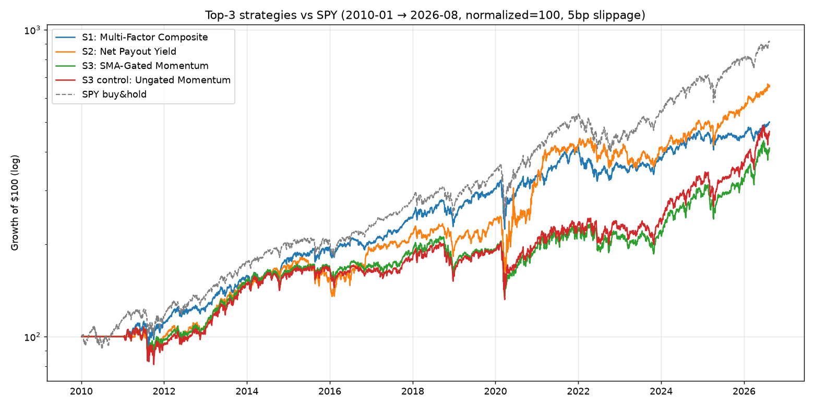
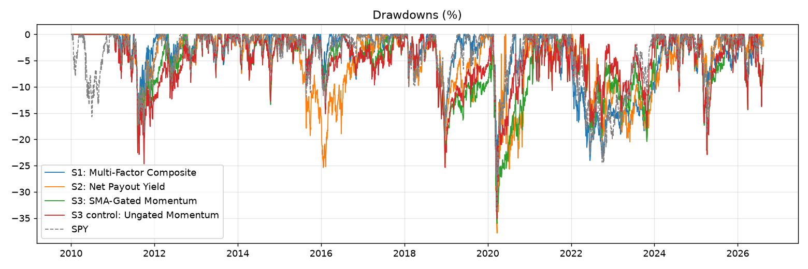

# Top-3 Portfolio Selection Strategies — Local LEAN Backtests

Native LEAN (.NET 10), local Sharadar-derived panel, 2010-01-04 → 2026-08-13, $100k, 5bp/side slippage.

## Combined metrics

| Strategy | CAGR | AnnVol | Sharpe | Sortino | MaxDD | WinRate(daily) | TotalReturn |
|---|---|---|---|---|---|---|---|
| S1: Multi-Factor Composite | 10.2% | 14.6% | 0.74 | 0.90 | -30.8% | 52% | 401% |
| S2: Net Payout Yield | 12.0% | 19.3% | 0.68 | 0.87 | -37.9% | 49% | 559% |
| S3: SMA-Gated Momentum | 8.9% | 18.8% | 0.55 | 0.67 | -36.0% | 51% | 312% |
| S3 control: Ungated Momentum | 9.7% | 19.7% | 0.57 | 0.71 | -35.1% | 51% | 366% |
| SPY buy&hold | 14.3% | 17.1% | 0.87 | 1.07 | -33.7% | 55% | 820% |

## Plots

- 
- 

## Per-strategy reports

- [S1 Multi-Factor Composite](./s1_composite.md) — [chart](./s1_composite.png) · [monthly](./s1_composite_monthly.png)
- [S2 Net Payout Yield](./s2_npy.md) — [chart](./s2_npy.png) · [monthly](./s2_npy_monthly.png)
- [S3 SMA-Gated Momentum](./s3_gated.md) — [chart](./s3_gated.png) · [monthly](./s3_gated_monthly.png)
- [S3 Gate Test (pre-registered)](./s3_gate_test.md)

## Interpretation (read before using these numbers)

- **Window regime:** 2010→2026 is dominated by a growth-led bull — the documented failure regime for value/low-vol defensive tilts (low-vol trailed SPY in 9 of these years; value drought 2007–17 extended). Expecting these tilts to *beat* SPY over THIS window contradicts the literature; the claim they test is risk-adjusted robustness across full cycles, not bull-market relative return.
- **S1 composite** delivers SPY-like participation at lower vol (14.6% vs 17.1%) with comparable MaxDD, CAGR 10.2% vs 14.3% — the ~4pp gap is concentrated in the growth-melt-up years, consistent with the pre-registered expectation that live full-cycle alpha is ~1–2%/yr, not 4%.
- **S2 NPY** has the best total return of the three (559%) but the deepest drawdown (−37.9%) — it is a value-concentrated sleeve; the B/M+NPY value-cluster overlap flagged in the integration plan is visible here. Size it accordingly.
- **S3 gate test FAILED the pre-registered criteria** (ΔSharpe −0.02 vs required +0.15; MaxDD ratio 1.03 vs required ≤0.75) → per protocol, the momentum leg stays **ungated raw**. This matches the red-team prediction (gate marginal ≈ 1–3%/yr, V-bottom double-de-risk). The gate remains a research hypothesis for a different (e.g. non-bull-dominated) window, not a deployable component.
- **Sharpe conventions:** table Sharpes are computed uniformly from daily equity curves (mean/std × √252, rf=0). LEAN's own summary reports slightly lower values (S1 0.464, S2 0.465, S3g 0.338, S3u 0.365) — different accounting (fees timing, rf convention); use the uniform column for cross-strategy comparison.
- **Universe caveat:** static 817-name snapshot (assembled 2026, includes delisted names' history). Survivorship bias inflates absolute numbers; the relative ordering is the usable signal. Confirm finalists on QC Cloud (local/cloud parity residual known ≈ ±0.4 Sharpe).
- **Full-cycle context:** these sleeves are designed to be overlaid on the parent regime detector, not run standalone vs SPY. Standalone comparison to buy-and-hold in a 16-year bull window is the harshest possible test by construction.

## Methodology notes

- Fundamentals: Sharadar SF1 (ART annual), filed-date (datekey) keyed with 90-day lag → no look-ahead. Coverage: 805/817 tickers.
- Universe caveat: static 817-name snapshot assembled 2026 (includes delisted names' history; partially PIT). Results are an upper bound vs a true point-in-time universe.
- Sharpe/Sortino/MaxDD computed from daily equity curves in this repo (LEAN summary stats cross-checked where available).
- Full literature base: see [`REPORT.md`](../literature/REPORT.md).