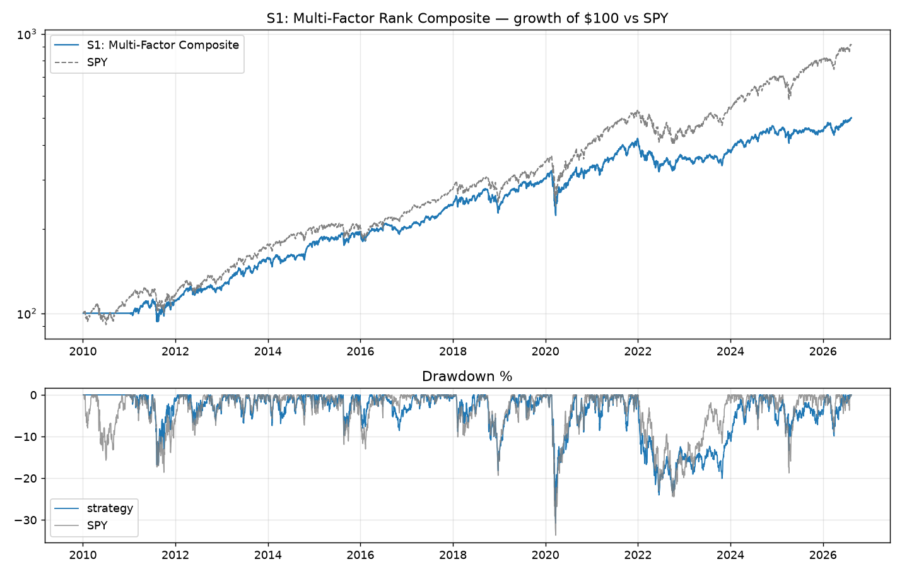
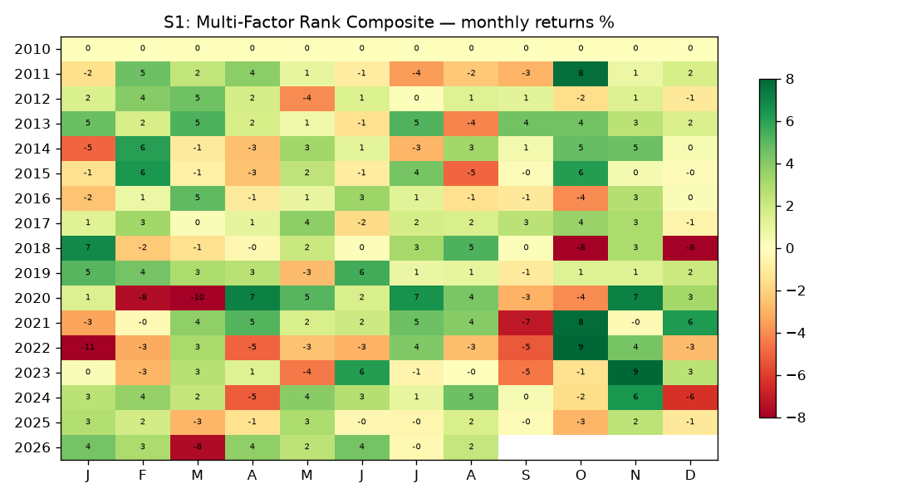

# S1: Multi-Factor Rank Composite

**Backtest window:** 2010-01-04 → 2026-08-13 · **Rebalances logged:** 187 · **Slippage:** 5bp/side

**Rule:** Top-1000-style universe (817-name local S&P panel), 4 equal cross-sectional ranks: value=B/M (Sharadar bvps, 90d filing lag), profitability=(revenue−cor)/assets, low-risk=−(252d vol), momentum=12-2. Top decile (30-100 names), equal-weight 3% cap, monthly rebalance. 5bp slippage/side.

**Literature base:** AMP 2013 (val+mom ρ≈−0.6); Novy-Marx 2013 (GP/TA α 0.52%/mo); BBW 2011 (large-cap low-vol); Novy-Marx 2016 (equal ranks, no in-sample weight fitting); McLean-Pontiff haircut applied in expectations.

## Metrics (computed from equity curve)

| Metric | Value |
|---|---|
| CAGR | 10.2% |
| Ann. vol | 14.6% |
| Sharpe | 0.74 |
| Sortino | 0.90 |
| Max drawdown | -30.8% |
| Daily win rate | 52% |
| Total return | 401% |

LEAN-reported: Sharpe 0.464 · CAGR 10.179% · DD 30.800% · orders 5000 · fees $$76412.45

## Caveats
- Universe = local Sharadar-derived 817-name panel (S&P-500-ish, includes delisted names whose zips end at delist date — partially PIT, but the *static list* was assembled in 2026 → treat results as an upper bound vs a true point-in-time universe).
- Prices are already split/dividend-adjusted (Sharadar closeadj convention); `Raw` normalization in LEAN.
- Fundamental signals use filing-date (datekey) + 90-day lag; SF1 raw dollars/shares — ratios are scale-consistent (AAPL sanity-checked).
- S3 gated-out capital sits in cash (LEAN cash yield = 0), so gated results are understated by ~the risk-free rate on parked capital.
- No transaction-cost stress grid was run; single 5bp/side assumption.
