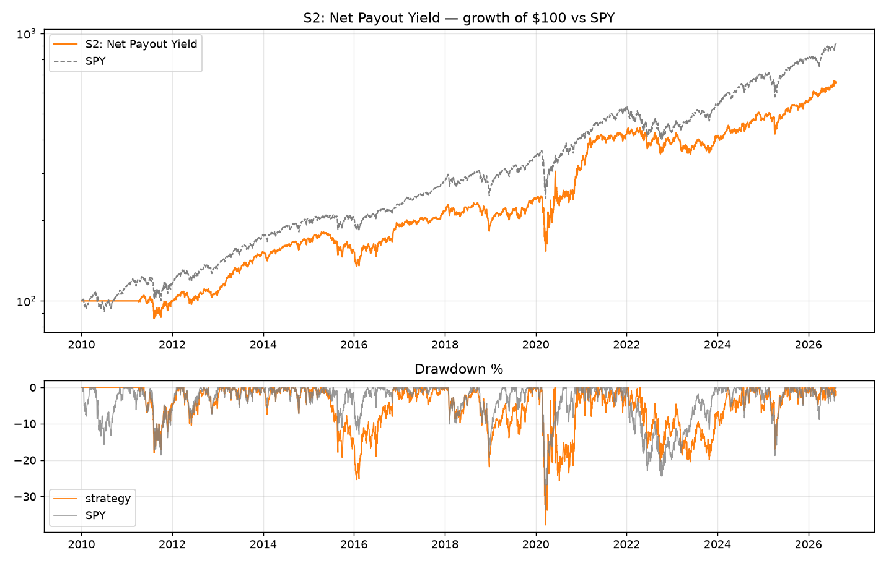
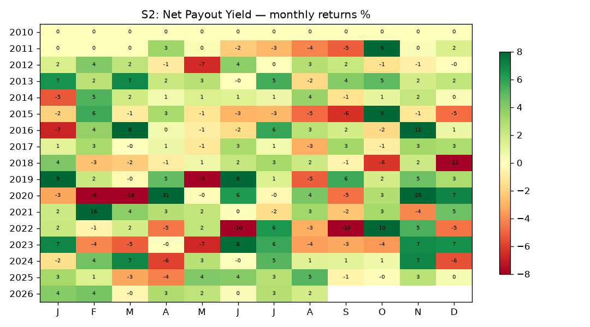

# S2: Net Payout Yield

**Backtest window:** 2010-01-04 → 2026-08-13 · **Rebalances logged:** 18 · **Slippage:** 5bp/side

**Rule:** NPY = (−ncfdiv − ncfcommon)/(sharesbas×price) with ncfo>0 guard, latest ART filing ≤ 90d old. Top decile (≥50 names), EW, annual April rebalance, 12m hold. 5bp slippage/side.

**Literature base:** Boudoukh et al. 2007 (D10−D1 = 0.73%/mo 1984-2003, monthly units verified); share-issuance family (Pontiff-Woodgate 2008). The large-cap expression of the insider-buys intuition.

## Metrics (computed from equity curve)

| Metric | Value |
|---|---|
| CAGR | 12.0% |
| Ann. vol | 19.3% |
| Sharpe | 0.68 |
| Sortino | 0.87 |
| Max drawdown | -37.9% |
| Daily win rate | 49% |
| Total return | 559% |

LEAN-reported: Sharpe 0.465 · CAGR 12.010% · DD 37.900% · orders 1511 · fees $$27192.10

## Caveats
- Universe = local Sharadar-derived 817-name panel (S&P-500-ish, includes delisted names whose zips end at delist date — partially PIT, but the *static list* was assembled in 2026 → treat results as an upper bound vs a true point-in-time universe).
- Prices are already split/dividend-adjusted (Sharadar closeadj convention); `Raw` normalization in LEAN.
- Fundamental signals use filing-date (datekey) + 90-day lag; SF1 raw dollars/shares — ratios are scale-consistent (AAPL sanity-checked).
- S3 gated-out capital sits in cash (LEAN cash yield = 0), so gated results are understated by ~the risk-free rate on parked capital.
- No transaction-cost stress grid was run; single 5bp/side assumption.
