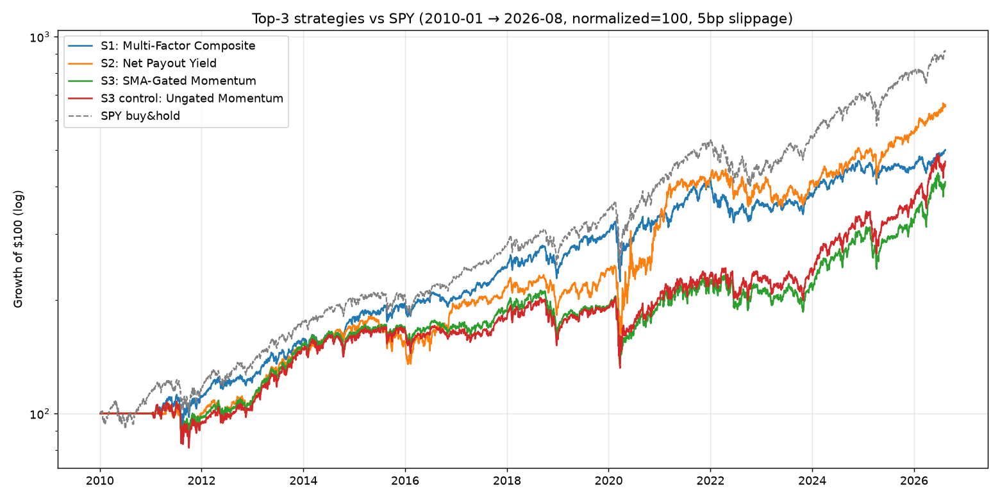

# S3 Pre-Registered Gate Test (gated vs ungated)

Pre-registered before the backtest ran: **PASS iff** holdout-window Sharpe(gated) ≥ Sharpe(ungated) + 0.15 AND MaxDD(gated) ≤ 75% × MaxDD(ungated).

| Strategy | CAGR | AnnVol | Sharpe | Sortino | MaxDD | WinRate(daily) | TotalReturn |
|---|---|---|---|---|---|---|---|
| gated | 8.9% | 18.8% | 0.55 | 0.67 | -36.0% | 51% | 312% |
| ungated | 9.7% | 19.7% | 0.57 | 0.71 | -35.1% | 51% | 366% |

- ΔSharpe: -0.02 (need ≥ +0.15) → ✘
- MaxDD ratio: 1.03 (need ≤ 0.75) → ✔

## VERDICT: **FAIL → revert momentum leg to ungated raw 12-2**

