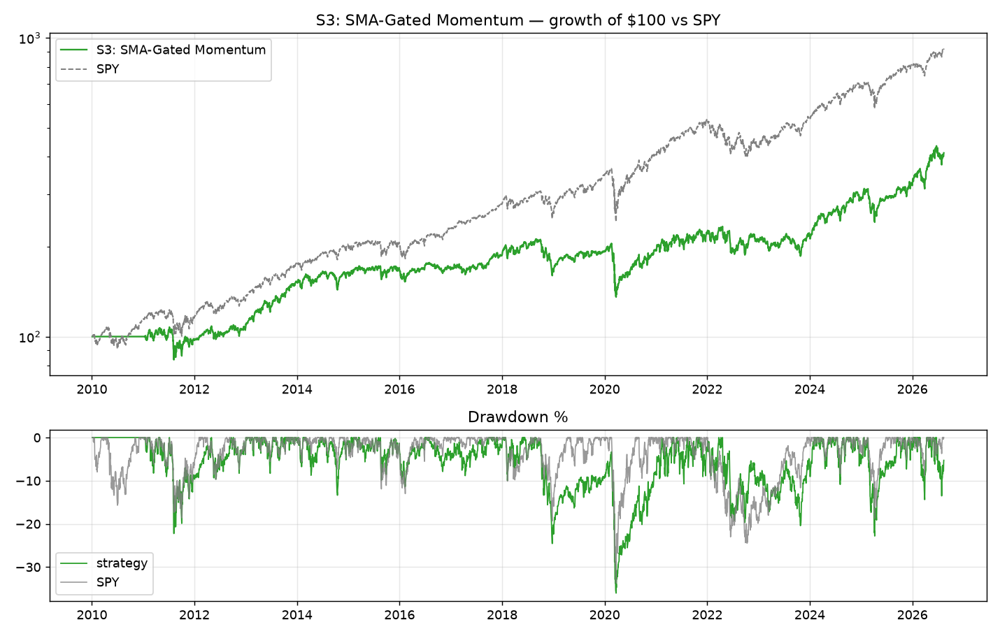
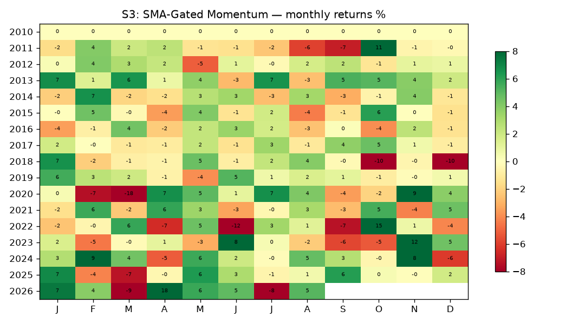

# S3: SMA-Gated Momentum

**Backtest window:** 2010-01-04 → 2026-08-13 · **Rebalances logged:** 187 · **Slippage:** 5bp/side

**Rule:** 12-1 momentum top decile (~100 names, EW, monthly); hold each name only while month-end close > its own ~10-month SMA (210 trading days); gated names' weight redistributed to passing names; <15 passing → all cash. 5bp slippage/side.

**Literature base:** Han-Yang-Zhou 2013 JFQA (per-stock MA timing, long-only-with-T-bills construction verified); Daniel-Moskowitz 2016 (crash mitigation); Faber 2007/2013 (10-month SMA family). Pre-registered go/no-go vs ungated basket.

## Metrics (computed from equity curve)

| Metric | Value |
|---|---|
| CAGR | 8.9% |
| Ann. vol | 18.8% |
| Sharpe | 0.55 |
| Sortino | 0.67 |
| Max drawdown | -36.0% |
| Daily win rate | 51% |
| Total return | 312% |

LEAN-reported: Sharpe 0.338 · CAGR 8.890% · DD 36.000% · orders 11748 · fees $$107004.58

## Caveats
- Universe = local Sharadar-derived 817-name panel (S&P-500-ish, includes delisted names whose zips end at delist date — partially PIT, but the *static list* was assembled in 2026 → treat results as an upper bound vs a true point-in-time universe).
- Prices are already split/dividend-adjusted (Sharadar closeadj convention); `Raw` normalization in LEAN.
- Fundamental signals use filing-date (datekey) + 90-day lag; SF1 raw dollars/shares — ratios are scale-consistent (AAPL sanity-checked).
- S3 gated-out capital sits in cash (LEAN cash yield = 0), so gated results are understated by ~the risk-free rate on parked capital.
- No transaction-cost stress grid was run; single 5bp/side assumption.
