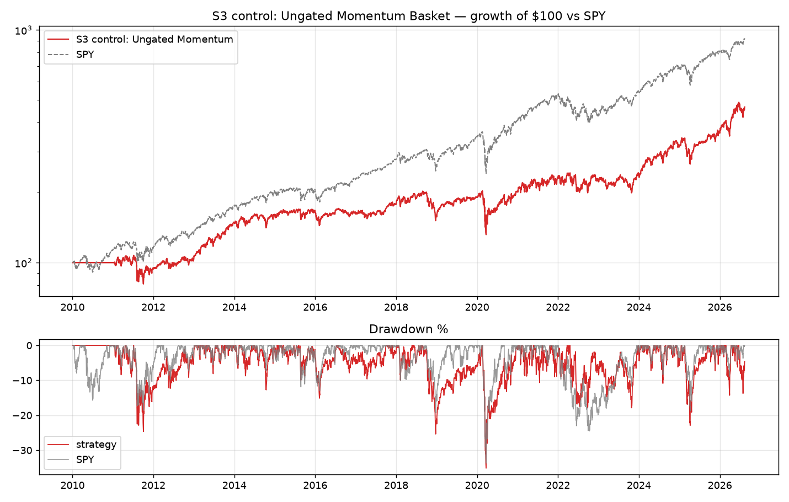
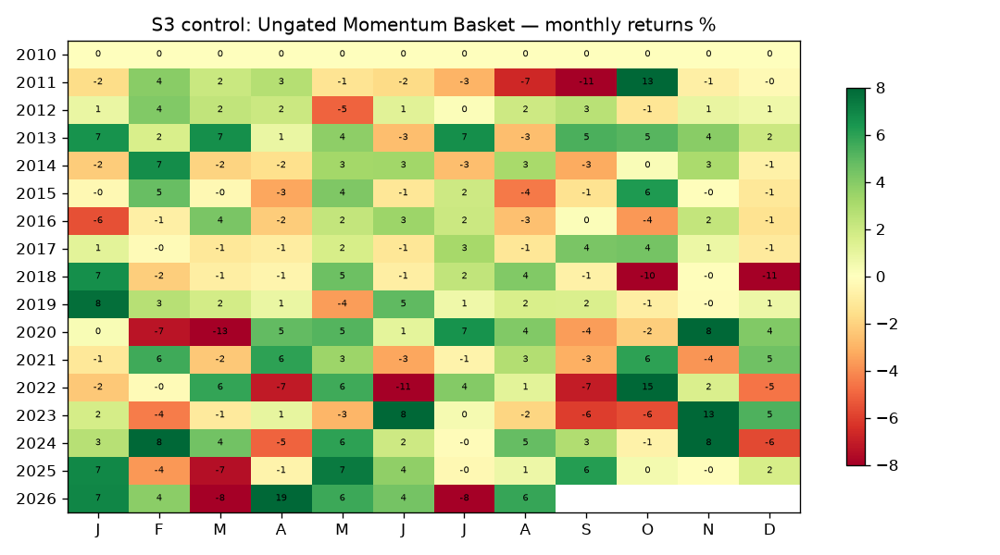

# S3 control: Ungated Momentum Basket

**Backtest window:** 2010-01-04 → 2026-08-13 · **Rebalances logged:** 0 · **Slippage:** 5bp/side

**Rule:** Same 12-1 momentum top-decile basket without the SMA gate. Control arm for the pre-registered gate test — not a deployable strategy on its own.

**Literature base:** Jegadeesh-Titman 1993; AMP 2013.

## Metrics (computed from equity curve)

| Metric | Value |
|---|---|
| CAGR | 9.7% |
| Ann. vol | 19.7% |
| Sharpe | 0.57 |
| Sortino | 0.71 |
| Max drawdown | -35.1% |
| Daily win rate | 51% |
| Total return | 366% |

LEAN-reported: Sharpe 0.365 · CAGR 9.710% · DD 35.100% · orders 11525 · fees $$108296.76

## Caveats
- Universe = local Sharadar-derived 817-name panel (S&P-500-ish, includes delisted names whose zips end at delist date — partially PIT, but the *static list* was assembled in 2026 → treat results as an upper bound vs a true point-in-time universe).
- Prices are already split/dividend-adjusted (Sharadar closeadj convention); `Raw` normalization in LEAN.
- Fundamental signals use filing-date (datekey) + 90-day lag; SF1 raw dollars/shares — ratios are scale-consistent (AAPL sanity-checked).
- S3 gated-out capital sits in cash (LEAN cash yield = 0), so gated results are understated by ~the risk-free rate on parked capital.
- No transaction-cost stress grid was run; single 5bp/side assumption.
